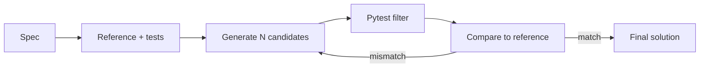

<h1 align="center">Multi-Agent Code Generation System</h1>

<p align="center">
  AI-generated code, checked against a reference it didn't write.
</p>

<p align="center">
  
  
  
</p>

---

Most AI coding tools let the model grade its own homework: it writes the code, writes the tests, and says everything passes. But model-written tests often assert the wrong answer, so "passes the tests" doesn't mean "correct."

**This system doesn't trust the tests.** For every problem it builds two independent solutions: a fast, optimized candidate and a slow, brute-force reference. Then it runs both on hundreds of random inputs. If they ever disagree, the exact failing input goes back to the generator to fix.

Two solutions written in completely different ways rarely share the same bug. When they agree everywhere, you can trust the answer.

## How it works



**Setup** writes the reference, checks it against the problem's examples, and caches its answers on ~300 inputs. **The loop** generates candidates, filters them with pytest, and compares the survivors to the reference until one matches everywhere.

## What's inside

| Component | What it does |
|---|---|
| **Reference** | Deliberately simple brute-force solution. Ignores speed, since optimization is where bugs hide. Uses the stronger model. |
| **Input generator** | Random valid inputs, kept small and aimed at edge cases. |
| **Tester** | Pytest suite written from the spec before any code exists. A cheap first filter. |
| **Generator** | Writes the optimized solution, N at a time, on a fast model. |
| **Differential check** | Runs candidates on every cached input and compares to the reference. The real judge. |

## Design choices

- **Agreement over self-grading.** Correctness comes from two independent solutions agreeing, not from one model checking itself.
- **The spec is the anchor.** The reference must reproduce the problem's stated examples before anything else trusts it.
- **Cheap check first.** Pytest runs before the full comparison, so broken code never costs more than it has to.
- **Weak generator, strong reference.** The generator's mistakes get caught, so it can be cheap. The reference's mistakes would poison everything, so it isn't.
- **Concrete feedback.** Failed attempts get the exact input, their wrong answer, and the right one.

## Quick start

```bash
pip install -r requirements.txt
echo "GEMINI_API_KEY=your-key" > .env
pytest            # offline tests, no API calls
python3 main.py   # solve the example problem
```

To try a different problem, edit `TASK` and `SPEC_EXAMPLES` in `main.py`. The output is saved to `output/`.

## Project layout

```
llm.py          model client, fast/strong model tiers
setup.py        reference, input generator, tests, answer cache
loop.py         generate → filter → compare → feedback
main.py         run it on one problem
test_setup.py   offline tests for setup
test_loop.py    offline tests for the loop
```

`test_loop.py` includes a solution that passes the pytest suite but is wrong for every even-sized window. The reference check catches it. That's the whole point of the project in one test.

## Limits

- If the model misreads the problem the same way in both solutions, they'll agree and both be wrong. The spec examples are the only guard.
- Inputs are kept small so the brute-force reference stays fast, so bugs that only show up at large sizes aren't tested.
- Generated code runs on your machine. Sandbox it if you don't trust it.
